# FR3 스포이드 실험 — 비커의 물을 빨간 칸에 떨어뜨리기 (GR00T N1.7, VLA + 수식)

> **지시문:** "put water from the beaker into the red hole with the dropper"

Franka FR3가 거치대에서 유리 스포이드를 뽑아, 비커에서 물을 빨아들인 뒤, 24칸 판에서 빨간 원판이 들어 있는 칸에 물을 떨어뜨린다.
학습 데이터는 학습된 모델 없이 고전적인 영상 처리와 궤적 계획으로 만든 **자동 시연 200판**이고, 이 데이터로 **GR00T N1.7**을 미세조정했다.
평가는 학습에 쓰지 않은 배치 10개에서 **VLA만**과 **VLA + 수식**을 조건마다 50판씩 돌렸다.

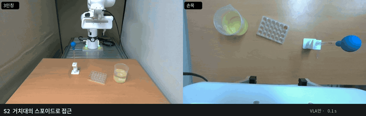

VLA만 성공 판 (T005) — VLA 혼자 거치대에서 스포이드를 뽑아 물을 빨고, 빨간 원판 1.3 mm 안에서 짬 · 3배 빠르게 · <a href="assets/demo.mp4">원래 속도 영상 (mp4)</a>

## 결과 한눈에

| | VLA만 | VLA + 수식 |
|---|---|---|
| **최종 성공 (S9, 빨간 원판에 물이 떨어짐)** | **9/50 (18%, 10–31)** | **24/50 (48%, 35–61)** |
| 스포이드를 쥐고 뽑음 (S6) | 48/50 (96%) | 49/50 (98%) |
| 물을 빨아들임 (S7) | 47/50 (94%) | 47/50 (94%) |
| VLA가 빨간 칸 20 mm 안까지 물을 옮김 (S8) | 25/50 (50%) | 26/50 (52%) |
| S8을 통과한 판 중 빨간 원판에 떨굼 | 9/25 (36%) | 24/26 (92%) |

- 최종 성공 차이: Fisher 정확 검정 p = 0.0026. 괄호 안은 Wilson 95% 구간이다.
- 두 조건은 S2–S8(접근 → 쥐기 → 뽑기 → 빨기 → 빨간 칸 근처까지 옮기기)이 거의 같다. 차이는 마지막 S9에서 난다.
  VLA가 빨간 칸 20 mm 안까지 데려온 판에서, VLA 혼자서는 9/25을 원판에 떨궜고, 수식이 마지막 맞춤을 넘겨받으면 24/26을 떨궜다.
- 남은 실패는 대부분 **VLA가 칸을 잘못 고른 판**이다. VLA가 짜려 한 자리가 빨간 칸에서 20 mm 넘게 떨어지면 수식은 빨간 칸으로 바꾸지 않는다(VLA + 수식 18판, 모두 부분).

## 목차
1. [과제와 장비](#1-과제와-장비)
2. [데이터 수집 (자동 시연)](#2-데이터-수집-자동-시연)
3. [학습](#3-학습)
4. [평가 방법](#4-평가-방법)
5. [결과 — S0–S10 벤치마크](#5-결과--s0s10-벤치마크)
6. [한계](#6-한계)
7. [파일](#7-파일)

---

## 1. 과제와 장비

| 항목 | 내용 |
|---|---|
| 로봇 | Franka Research 3 (FR3) + Franka Hand 그리퍼 |
| 카메라 | Intel RealSense D405 2대 — 3인칭(앞에서 봄), 손목. 컬러 848×480, 기록·학습 10 Hz |
| 물체 | 유리 스포이드(파란 고무공), 스포이드 거치대, 물이 든 비커, 24칸 판(4 × 6, 칸 간격 19.3 mm) |
| 목표 표시 | 3D 프린트 빨간 원판(지름 14.5 mm)을 칸 하나에 넣음 — 판마다 칸이 바뀜 |
| 지시문 | "put water from the beaker into the red hole with the dropper" (하나만 씀) |

한 판의 순서는 다음과 같다.

1. 홈 자세에서 시작
2. 거치대에 꽂힌 스포이드의 고무공을 쥐고 위로 뽑음
3. 비커로 옮겨 고무공을 살짝 누른 채 끝을 물에 담그고, 풀어서 물을 빨아들임
4. 빨간 원판이 든 칸 위로 옮겨 고무공을 짜서 물을 떨어뜨림
5. 스포이드를 거치대에 다시 꽂고 홈으로

그리퍼는 손가락 폭으로 네 단계를 쓴다: 열림 → 쥠(약 26 mm) → 빨기 전 살짝 누름(쥠 − 0.2 mm) → 칸에서 짬(약 24.3 mm). 손가락 폭 몇 mm 차이로 물의 양을 다룬다.

### 실행 장면

VLA만으로 성공한 판(T005, 빨간 원판 가운데에서 1.3 mm)이다. VLA + 수식 판은 수식이 짜는 동안 기록이 끝나서, 처음부터 끝까지 기록된 이 판을 실었다.

| | 1. 시작 | 2. 쥐기 | 3. 옮기기 | 4. 떨어뜨리기 |
|---|---|---|---|---|
| 3인칭 | 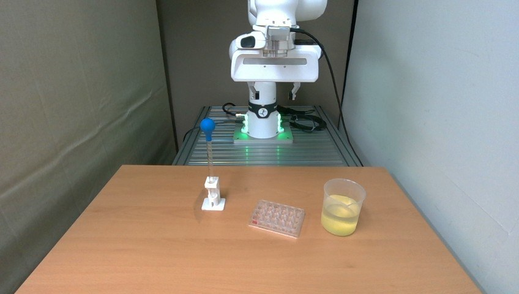 | 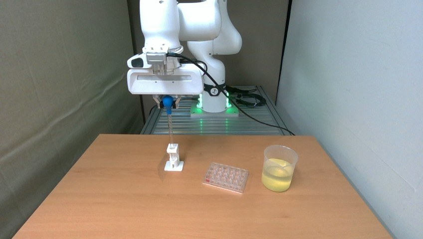 | 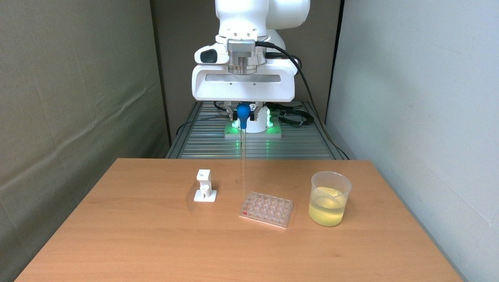 | 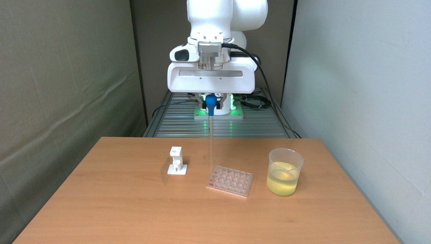 |
| 손목 | 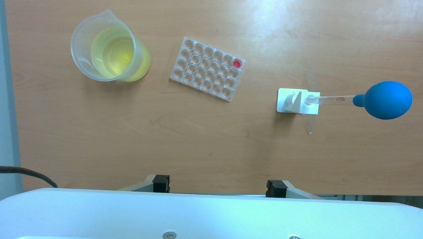 | 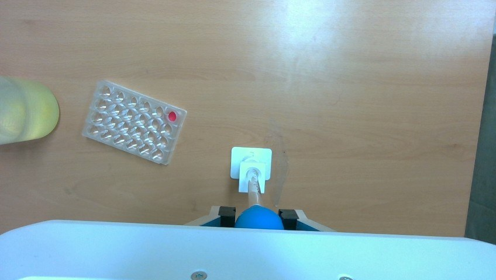 | 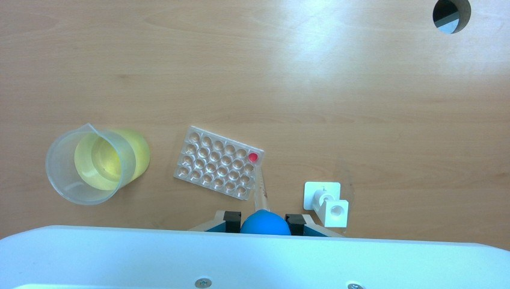 | 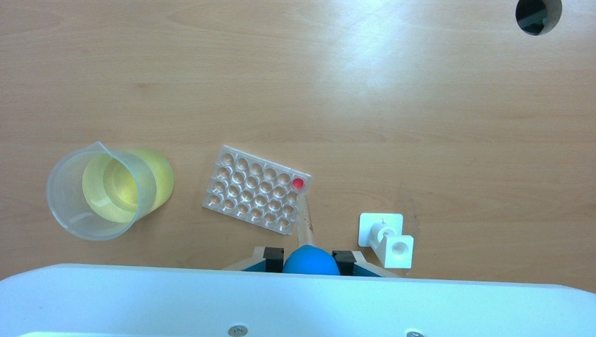 |

## 2. 데이터 수집 (자동 시연)

사람이 조종하지 않고, 스테이션이 스스로 동작을 계획해 실행하면서 기록했다. 학습된 모델은 쓰지 않았다.

| 항목 | 값 |
|---|---|
| 판 수 | **200판** (모두 성공 판, 물이 빨간 원판 위에 떨어진 판만 저장) |
| 배치 | 배치 계획 100개 × 2판. 판마다 판·빨간 칸·비커·거치대를 모두 옮김 |
| 빨간 칸 | 24칸 모두 사용 (칸마다 4–12판) |
| 판 자리·각도 | 빨간 칸 x 473–623 mm, y -104–80 mm (5–95%), 판 각도 -28° – +20° |
| 비커 · 거치대 | 로봇 양옆(y ±100–260 mm)에 번갈아, 비커 x 503–656 mm, 거치대 x 431–623 mm |
| 한 판 길이 | 가운데값 70.8 s (60.7–79.6 s). 학습에서는 멈춰 서 있는 구간을 줄여 판당 62.2 s |
| 학습 프레임 | 124,425프레임 (207분, 10 Hz) |
| 기록 | 3인칭·손목 사진, 관절, 손끝 위치·자세, 그리퍼 폭, 명령 |

**자동 시연이 하는 일**

- 홈 자세 손목 사진 한 장에서 24칸 판(칸 무늬 맞추기)과 빨간 원판, 비커 입구 원, 거치대를 찾는다. 화면 좌표는 손으로 맞춘 정답 쌍으로 보정한 평면 변환으로 로봇 좌표로 바꾼다.
- 거치대는 스포이드 위로 가서 손목 화면의 파란 고무공을 맞춰 잡는 자리를 잰다(이 동작은 기록하지 않음).
- 잡기 → 뽑기 → 비커 → 칸 → 다시 꽂기까지 궤적을 계획하고, 칸 위에서는 손목 화면으로 빨간 원판을 보고 끝 자리를 한 번 더 맞춘 뒤 내려가 짠다.
- 판마다 스테이션이 기록 품질(끊김, 그리퍼 순서, 사진 차이 등)을 자동 점검했다. 200판 중 1판(거치대에서 쥔 직후 손가락이 너무 닫힘)을 빼고, 같은 배치로 1판을 다시 모아 200판을 맞췄다.

### 배치 분포

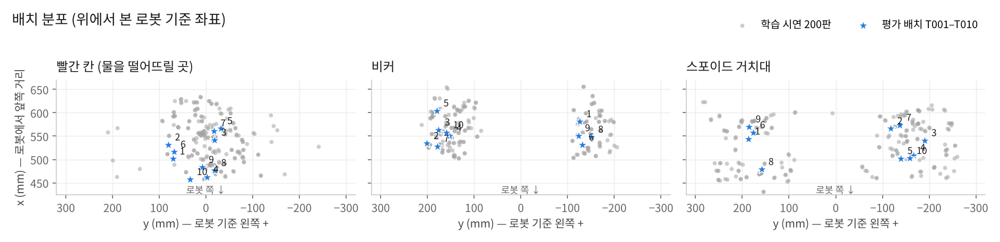

- 회색 점은 학습 시연 200판(뺀 89번 판 대신 다시 모은 판은 같은 배치라 89번 자리로 그림), 파란 별은 평가 배치 T001–T010이다(평가 때 스테이션이 잰 자리, 같은 배치 판들의 가운데값).
- 평가 배치는 수집에 쓰지 않았다. 스테이션이 모은 판들과 **가장 먼 배치부터** 골랐기 때문에, 데이터 가장자리에 있는 배치가 많다.
- T010은 빨간 칸이 로봇 쪽 끝(x 457 mm)에 있어, 학습 빨간 칸이 거의 없는 곳이다.

## 3. 학습

| 항목 | 값 |
|---|---|
| 모델 | GR00T N1.7 (3B), LeRobot으로 미세조정. 비전·언어 백본은 고정 |
| 데이터 | 자동 시연 200판 전부 (검증용으로 따로 빼지 않음) |
| 입력 | 3인칭·손목 사진 + 상태 10차원(손끝 위치 3 + 자세 rot6d 6 + 그리퍼 단계 1) + 지시문 |
| 행동 | 16스텝(1.6 s) 묶음, 손끝 위치·자세 + 그리퍼 단계. 위치·자세는 상대 행동으로 학습(그리퍼 제외) |
| 설정 | 30,000스텝, 배치 32 × 2, 학습률 1e-4 코사인, bf16, 사진 증강 켬, 5,000스텝마다 저장 |
| 평가에 쓴 체크포인트 | **25,000스텝** (약 12.8 epoch) |

- 시간이 부족해 체크포인트를 실물로 비교해 고르지 않고 25,000스텝 하나로 정했다.
- 학습 loss는 30,000스텝까지 계속 내려갔다(5K 0.043 → 25K 0.0125 → 30K 0.011).

## 4. 평가 방법

### 4.1 설계 (결과를 보기 전에 정함)

- **배치:** 학습에 쓰지 않은 T001–T010. 사람이 배치 그림대로 판·빨간 원판·비커·거치대를 놓았다.
- **판 수:** 배치마다 조건별 5판 → **조건마다 50판**. 배치를 한 번 놓고 두 조건을 번갈아 돌렸다(예: VLA·수식·수식·VLA …). 다시 놓으면 자리가 10–30 mm 달라지기 때문이다.
- **묶음:** 평가 배치의 빨간 칸에서 20 mm 안에 학습 빨간 칸이 몇 판 있는지(계획 배치 기준)로 미리 나눴다.

| 묶음 | 배치 (학습 빨간 칸 20 mm 안 판 수) |
|---|---|
| 가까움 | T003 (13) · T007 (20) · T008 (10) · T009 (14) |
| 중간 | T001 (4) · T004 (4) · T005 (8) |
| 멂 | T002 (2) · T006 (2) · T010 (0) |

- **판정:** 사람 판정이 최종이다.
  - 성공: 빨간 원판 위에 물이 떨어짐
  - 부분: 스포이드를 쥐었지만 성공하지 못함
  - 실패: 스포이드를 쥐지 못함 (안전장치가 멈춘 판도 결과로 셈)
- **무효 (다시 돌림):** 시작 전 장면을 못 잰 판(S0) 3, 조건을 잘못 고른 판 1, 순서를 틀린 판 1.
- VLA + 수식은 첫 배치(T001)를 돌리는 동안 넘겨받는 규칙을 마지막 형태(4.2절)로 고쳤다. 그 전에 돌린 3판은 빼고 다시 돌려, 본 결과 50판은 모두 같은 규칙이다. VLA만은 처음부터 끝까지 같은 설정이다.
- **본 결과에서 뺀 판 2:** 실행 도중 'VLA + 수식' 체크가 켜져 두 조건이 섞인 판 1(T001, 성공), T001 VLA + 수식 5판을 채운 뒤 더 돌린 판 1(성공). `data/eval_runs_excluded.csv`에 따로 남겼다. 섞인 판 대신 T001 VLA만 1판을 평가 마지막에 다시 돌려 배치마다 5판을 맞췄다.
- **자동 판정 검토:** 자동 판정은 "쥔 자리가 거치대 잡는 자리에서 10 mm 안"일 때만 쥠으로 본다. 그래서 10–13 mm 옆을 쥐고도 뽑기·빨기·짜기까지 한 5판(모두 VLA만)이 자동으로 실패가 됐다. 미리 정한 기준대로 부분으로 고쳤다.

### 4.2 두 조건

| | VLA만 | VLA + 수식 |
|---|---|---|
| 잡기 | VLA | VLA가 고무공 25 mm(높이 40 mm) 안에서 쥐려 하면 수식이 넘겨받아 쥐고 뽑음 |
| 빨기·옮기기 | VLA | VLA |
| 짜기 | VLA | VLA가 판 위로 내려가거나 짜려 할 때, VLA 끝이 **빨간 칸 20 mm 안**이면 수식이 빨간 원판을 보고 맞춰 짬. 아니면 VLA 끝에서 9 mm 안의 칸에 짬 |
| 거치대에 다시 꽂기 (S10) | 수식 (점수에 안 셈) | 수식 (점수에 안 셈) |

- 수식은 VLA가 데려온 자리 근처에서만 동작한다. 20 mm는 칸 간격(19.3 mm)과 거의 같다. VLA가 옆 칸 쪽으로 반 칸 넘게 갔어도 빨간 칸이 20 mm 안이면 빨간 칸에 짜므로, 이 범위 안에서는 수식이 칸을 고친 셈이다(5.4절).
- 수식이 넘겨받는 판단은 VLA가 보낸 손끝 명령에, 멈춰 있을 때 잰 "실제 − 명령" 처짐(몇 mm)을 더한 자리로 한다.

### 4.3 실행 설정 (두 조건 같음)

- 추론 서버에서 16스텝 묶음을 받아 앞 8스텝을 실행하고, 실행하는 동안 다음 묶음을 미리 요청한다. 추론 가운데값 약 130 ms.
- 이어 붙일 때 새 묶음 앞 4스텝을 앞 묶음과 섞어 속도가 꺾이지 않게 했다.
- 안전장치: 손끝 작업 상자, 책상 위 높이 하한, 손 기울기 15°, 0.1 s에 4 cm 넘는 행동이면 멈춤.

## 5. 결과 — S0–S10 벤치마크

### 5.1 단계 정의

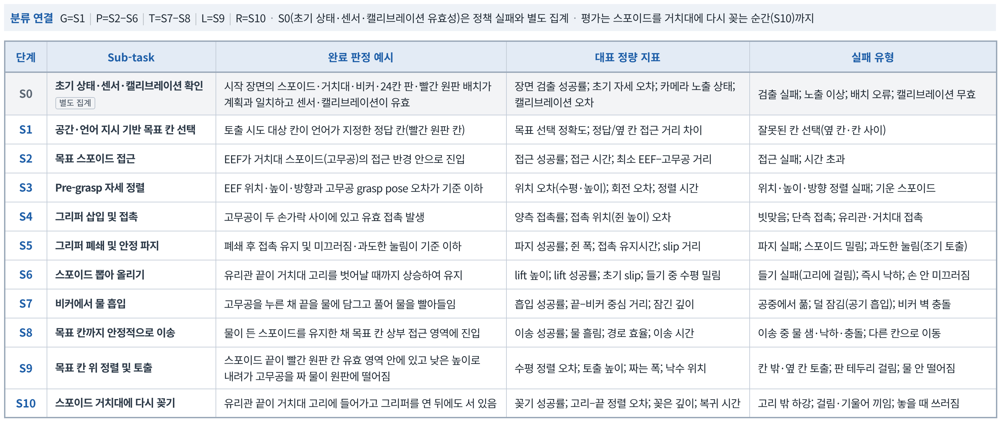

이 평가에서 쓴 판정은 아래와 같다.

- **S1 목표 칸 선택:** VLA가 짜려 한 자리에서 가장 가까운 칸이 빨간 칸인지. VLA만은 VLA가 짠 자리, VLA + 수식은 수식이 넘겨받을 때 VLA 끝 자리로 본다. 다른 단계와 시점이 달라 누적에 넣지 않고 따로 센다. 끝 자리는 관절값과 스포이드 길이로 계산한 값이라 몇 mm 오차가 있다. VLA만 성공 3판은 계산상 옆 칸이 더 가까웠지만(빨간 칸에서 13.2–16.8 mm), 사람이 원판에 물이 떨어진 것을 확인했다.
- **S2 접근:** 손끝이 거치대 잡는 자리 수평 25 mm·높이 40 mm 안으로 들어감.
- **S3–S5 정렬·접촉·파지:** 힘 센서가 없어 셋을 나눌 수 없어 "실제로 쥐었는지"(뽑기·빨기로 확인) 하나로 센다.
- **S6 뽑아 올리기:** 쥔 채 50 mm 넘게 올라감.
- **S7 물 빨기:** 끝이 비커 안 물속에 있을 때 고무공을 풂.
- **S8 이송:** 물이 든 채 VLA가 짜려 한 자리가 빨간 칸 20 mm 안. 수식이 빨간 칸으로 넘겨받는 범위와 같다.
- **S9 토출:** 사람 판정 성공(빨간 원판에 물이 떨어짐).
- **S10 거치대에 다시 꽂기:** 두 조건 모두 수식이 했고 점수에 넣지 않았다. 기록상 걸림 없이 꽂고 놓은 판을 센다(사람이 따로 판정하지 않음).
- 채점: 판마다 처음 막힌 단계를 정하고, 그 뒤 단계는 모두 실패로 센다. 뒤 단계를 통과했으면 앞 단계도 통과로 본다.

### 5.2 단계별 결과

| 단계 | 분류 | Sub-task | VLA만 | VLA + 수식 |
|---|---|---|---|---|
| S0 | — | 초기 상태·센서·캘리브레이션 (별도 집계) | 2판 (컨트롤러 꺼짐 1, 거치대 재기 실패 1) → 무효, 다시 돌림 | 1판 (거치대 재기 실패) → 무효, 다시 돌림 |
| S1 | G | 목표 칸 선택 (따로 셈) | 11/45 (24%) | 14/47 (30%) |
| S2 | P | 스포이드 접근 | 49/50 (98%) | 49/50 (98%) |
| S3–S5 | P | 정렬·접촉·파지 | 48/50 (96%) | 49/50 (98%) |
| S6 | P | 뽑아 올리기 | 48/50 (96%) | 49/50 (98%) |
| S7 | T | 비커에서 물 빨기 | 47/50 (94%) | 47/50 (94%) |
| S8 | T | 빨간 칸까지 이송 (20 mm 안) | 25/50 (50%) | 26/50 (52%) |
| **S9** | **L** | **빨간 원판에 토출 (최종 성공)** | **9/50 (18%, 10–31)** | **24/50 (48%, 35–61)** |
| S10 | R | 거치대에 다시 꽂기 (수식, 점수 밖) | 43/43 | 43/46 (입구에 걸림 3) |

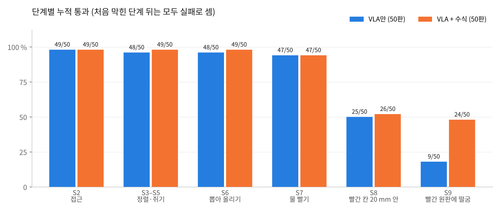

단계 전환 (앞 단계를 통과한 판 중 이 단계를 통과한 비율):

| | S2 | S3–S5 | S6 | S7 | S8 | S9 |
|---|---|---|---|---|---|---|
| VLA만 | 49/50 | 48/49 | 48/48 | 47/48 | 25/47 | 9/25 |
| VLA + 수식 | 49/50 | 49/49 | 49/49 | 47/49 | 26/47 | 24/26 |

분류별 (G / P / T / L / R):

| 분류 | VLA만 | VLA + 수식 |
|---|---|---|
| G 목표 칸 선택 (S1) | 11/45 | 14/47 |
| P 쥐고 뽑기 (S2–S6) | 48/50 | 49/50 |
| T 빨기·옮기기 (S7–S8, P 통과 판 중) | 25/48 | 26/49 |
| L 토출 (S9, T 통과 판 중) | 9/25 | 24/26 |
| R 다시 꽂기 (S10, 수식) | 43/43 | 43/46 |

처음 막힌 단계:

| 처음 막힌 단계 | VLA만 | VLA + 수식 |
|---|---|---|
| S2 접근 못 함 | 1 | 1 |
| S3–S5 못 쥠 | 1 | 0 |
| S6 못 뽑음 | 0 | 0 |
| S7 못 빪 | 1 | 2 |
| S8 빨간 칸 20 mm 밖 | 22 | 21 |
| S9 원판 밖에 떨굼 | 16 | 2 |
| 통과 (성공) | 9 | 24 |

- 안전장치 멈춤(0.1 s에 4 cm 넘는 행동)은 조건마다 3판씩이었다. VLA만은 잡기 전 1, 빨기 중 1, 판 위 1이고, VLA + 수식은 시작 직후 1, 빨기 중 2다.

### 5.3 최종 성공 — 묶음별 · 배치별

| 묶음 (평가 전에 정함) | VLA만 | VLA + 수식 | Fisher p |
|---|---|---|---|
| 가까움 (T003 · T007 · T008 · T009) | 4/20 (20%, 8–42) | 11/20 (55%, 34–74) | 0.048 |
| 중간 (T001 · T004 · T005) | 4/15 (27%, 11–52) | 7/15 (47%, 25–70) | 0.45 |
| 멂 (T002 · T006 · T010) | 1/15 (7%, 1–30) | 6/15 (40%, 20–64) | 0.08 |
| **전체** | **9/50 (18%, 10–31)** | **24/50 (48%, 35–61)** | **0.0026** |

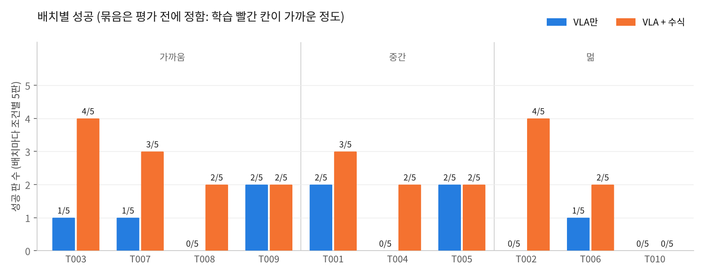

배치별 표

| 배치 | 묶음 | 빨간 칸 (x, y mm) | 학습 빨간 칸 20 mm 안 | VLA만 | VLA + 수식 |
|---|---|---|---|---|---|
| T003 | 가까움 | 2번 (542, -19) | 13 | 1/5 | 4/5 |
| T007 | 가까움 | 5번 (561, -17) | 20 | 1/5 | 3/5 |
| T008 | 가까움 | 16번 (476, -18) | 10 | 0/5 | 2/5 |
| T009 | 가까움 | 23번 (483, +8) | 14 | 2/5 | 2/5 |
| T001 | 중간 | 13번 (501, +70) | 4 | 2/5 | 3/5 |
| T004 | 중간 | 20번 (462, -2) | 4 | 0/5 | 2/5 |
| T005 | 중간 | 6번 (566, -32) | 8 | 2/5 | 2/5 |
| T002 | 멂 | 1번 (531, +80) | 2 | 0/5 | 4/5 |
| T006 | 멂 | 7번 (516, +68) | 2 | 1/5 | 2/5 |
| T010 | 멂 | 19번 (457, +34) | 0 | 0/5 | 0/5 |

### 5.4 VLA가 짜려 한 자리와 수식이 넘겨받은 결과

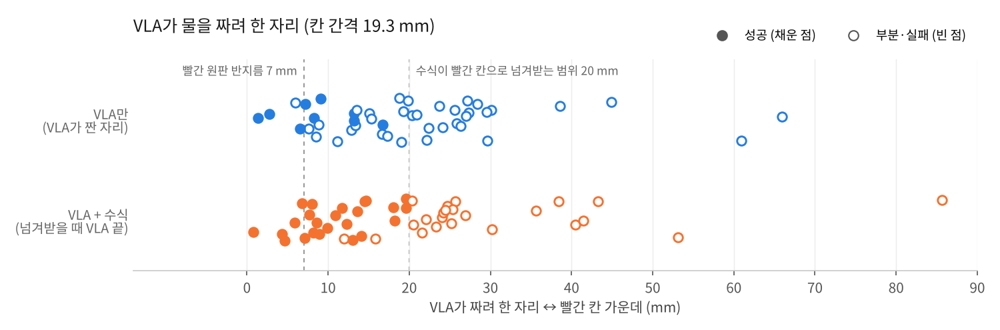

- VLA가 짜려 한 자리 ↔ 빨간 칸 가운데: VLA만 가운데값 19.0 mm (45판), VLA + 수식 18.2 mm (47판). 두 조건에서 VLA가 가는 자리는 비슷하다.
- VLA만의 성공 9판은 모두 VLA가 빨간 칸 16.8 mm 안에서 짰다. 원판 반지름 7 mm 안에서 짠 판은 4판뿐이다.

| 수식 넘김 (VLA + 수식 50판) | 판 수 | 결과 |
|---|---|---|
| 잡기를 넘겨받음 | 49 | 49판 모두 쥐고 뽑음 |
| 잡기를 못 넘겨받음 | 1 | 시작 1.5 s에 안전장치 멈춤 (실패) |
| 빨간 칸 20 mm 안 → 빨간 칸에 짬 | 26 | 성공 24, 부분 2 (원판을 빗맞춤 1, 칸으로 내려가다 판 테두리에 걸림 1) |
| └ 그중 VLA가 스스로 빨간 칸에 가장 가깝게 간 판 | 13 | 나머지 13판은 VLA가 옆 칸에 더 가까웠지만 빨간 칸이 20 mm 안이라 빨간 칸에 짬 |
| 빨간 칸 20 mm 밖 → VLA 끝 9 mm 안의 칸에 짬 | 18 | 모두 부분 (VLA 끝 ↔ 빨간 칸 20.3–53.1 mm) |
| 짜기를 넘겨받지 않음 | 6 | 빨기 중 안전 멈춤 2, VLA가 칸 사이·먼 곳에서 바로 짬 3 (30–86 mm), 시작 직후 멈춤 1 |

**수식이 넘겨받는 범위를 넓히면?** 기록된 판으로 다시 계산한 어림이다(실제로 돌린 결과가 아니다). 수식이 빨간 원판에 맞춰 짠 성공률을 이번과 같은 92%로 놓았다.

| 빨간 칸으로 넘겨받는 범위 | 예상 성공 | 빨간 칸에 짠 판 | 그중 수식이 VLA가 간 칸을 바꾼 판 |
|---|---|---|---|
| 20 mm (이번 평가) | 24/50 (48%) | 26 | 13 (50%) |
| 25 mm | 32/50 (65%) | 35 | 22 (63%) |
| 30 mm | 36/50 (72%) | 39 | 26 (67%) |
| 40 mm | 38/50 (76%) | 41 | 28 (68%) |

범위를 넓히면 성공률은 오르지만, 수식이 VLA 대신 칸을 고르는 비율도 함께 오른다. 칸 간격(19.3 mm)보다 넓은 범위에서는 "VLA가 목표를 고르고 수식은 마지막 맞춤만 한다"는 역할 나눔이 약해진다. 그래서 이번 평가는 20 mm로 고정했다.

### 5.5 T010 — 학습 범위 밖 배치

- T010의 빨간 칸은 로봇 쪽 끝(x 457, y +34 mm)에 있다. 계획 배치 기준으로는 20 mm 안에 학습 빨간 칸이 하나도 없었고, 실제로 놓인 자리 기준으로도 가장 가까운 학습 빨간 칸이 19 mm였다.
- 10판 모두(조건마다 5판) VLA가 짜려 한 자리가 빨간 칸에서 20–86 mm 떨어졌다. 방향도 매번 같았다: 빨간 칸보다 −y 쪽, 즉 학습 빨간 칸이 몰린 가운데 쪽으로 20–86 mm 갔다.
- 수식은 빨간 칸 20 mm 밖에서는 칸을 바꾸지 않으므로, VLA + 수식도 0/5다. 수식은 VLA가 데려온 자리를 다듬을 뿐이고, 학습 범위 밖에서 VLA가 고른 목표가 틀리면 고치지 못한다.

### 5.6 걸린 시간

- 성공 판 가운데값: VLA만 56.2 s (46–70 s), VLA + 수식 65.7 s (61–81 s). 수식은 잡기·짜기 전에 멈춰 맞추는 시간이 들어간다(거치대에 다시 꽂는 시간은 뺌).
- VLA가 직접 쥔 자리는 거치대 잡는 자리에서 가운데값 5.9 mm (0.8–13.0 mm)였다.

## 6. 한계

- 조건마다 50판, 배치마다 5판이다. 배치별·묶음별 차이는 판 수가 적어 대부분 통계적으로 확정되지 않는다(가까움 묶음만 p < 0.05).
- 평가는 이틀(11-24 오후, 11-25 오전)에 걸쳐 배치 차례대로 했다. 한 배치 안에서는 두 조건을 번갈아 돌려 같은 조건에서 비교했다.
- 체크포인트는 실물로 비교해 고르지 않았다(25,000스텝 하나).
- S3–S5는 힘·접촉 센서가 없어 나누지 못했다. S10은 두 조건 모두 수식이 했고 사람이 따로 판정하지 않았다.
- "VLA + 수식"은 20 mm 범위 안에서 VLA가 고른 칸을 빨간 칸으로 바꿀 수 있다(빨간 칸 짜기 26판 중 13판). 그래서 VLA + 수식의 성공에는 수식의 칸 고르기도 일부 들어 있다.
- 학습 때 본 배치에서의 성능은 재지 않았다.

## 7. 파일

| 파일 | 내용 |
|---|---|
| `data/eval_runs.csv` | 평가 판마다: 배치, 묶음, 조건, 결과, 판정한 사람/자동/검토, 처음 막힌 단계, S1–S10, VLA가 짜려 한 자리 ↔ 빨간 칸 거리, 수식 넘김 |
| `data/eval_layouts.csv` | 평가 배치 T001–T010의 빨간 칸·비커·거치대 자리, 학습 빨간 칸까지 거리 |
| `data/train_layouts.csv` | 학습 시연 200판의 빨간 칸·판·비커·거치대 자리 |
| `assets/` | 그림, 사진, 영상 |

좌표는 로봇 기준 mm다(x: 로봇에서 앞쪽, y: 로봇 기준 왼쪽 +).
