# FR3 스포이드 실험 — 비커의 물을 빨간 칸에 떨어뜨리기 (GR00T N1.7 · VLA + 수식)

> **지시문:** "put water from the beaker into the red hole with the dropper"

Franka FR3가 거치대에 꽂힌 유리 스포이드를 뽑아, 비커에서 물을 빨아들인 뒤, 24칸 판에서 빨간 원판이 들어 있는 칸에 물을 떨어뜨린다.
학습 데이터는 학습된 모델 없이 고전적인 영상 처리와 궤적 계획으로 만든 **자동 시연 200판**이고, 이 데이터로 **GR00T N1.7**을 미세조정했다.
평가는 학습에 쓰지 않은 배치 10개에서 **VLA만**과 **VLA + 수식**을 조건마다 50판씩 돌렸다.

<table><tr>
<td align="center" width="50%"> <b>VLA만</b> — T005, VLA 혼자 거치대에서 뽑아 물을 빨고 빨간 원판 1.3 mm 안에서 짬 · 3배 빠르게 · <a href="FR3_spoid_results/FR3_dropper/assets/demo_vla.mp4">원래 속도 (mp4)</a></td>
<td align="center" width="50%"> <b>VLA + 수식</b> — T003, 주황 글씨 구간은 수식이 움직임 (잡기 · 원판 보고 맞춰 짜기) · 3배 빠르게 · <a href="FR3_spoid_results/FR3_dropper/assets/demo_hybrid.mp4">원래 속도 (mp4)</a></td>
</tr></table>

VLA + 수식 판은 수식이 짜는 순간 기록이 끝나서, 영상도 짜기 직전에서 끝난다.

## 결과 한눈에

| | VLA만 | VLA + 수식 |
|---|---|---|
| **최종 성공 (S9, 빨간 원판에 물이 떨어짐)** | **9/50 (18%, 10–31)** | **24/50 (48%, 35–61)** |
| 스포이드를 쥐고 뽑음 (S6) | 48/50 (96%) | 49/50 (98%) |
| 물을 빨아들임 (S7) | 47/50 (94%) | 47/50 (94%) |
| 물을 빨간 칸 20 mm 안까지 옮김 (S8) | 25/50 (50%) | 26/50 (52%) |
| S8을 통과한 판 중 빨간 원판에 떨굼 | 9/25 (36%) | 24/26 (92%) |

- 최종 성공 차이: Fisher 정확 검정 p = 0.0026. 괄호 안 두 번째 값은 Wilson 95% 구간이다.
- 두 조건은 S2–S8(접근 → 쥐기 → 뽑기 → 빨기 → 빨간 칸 근처까지 옮기기)이 거의 같고, 차이는 마지막 S9에서 난다.
- 남은 실패는 대부분 VLA가 빨간 칸에서 20 mm 넘게 떨어진 곳(옆 칸 쪽)으로 간 판이다(S8 실패: VLA만 22판, VLA + 수식 21판).

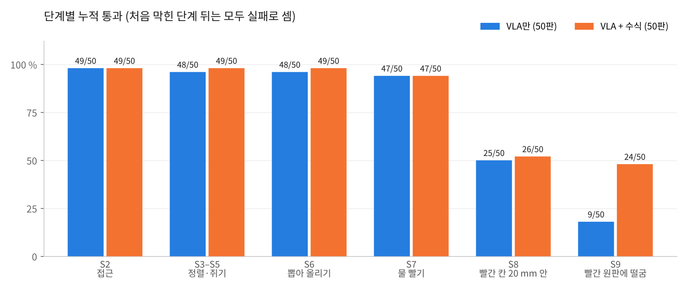

## 목차
1. [과제와 장비](#1-과제와-장비)
2. [데이터 수집 (자동 시연)](#2-데이터-수집-자동-시연)
3. [학습](#3-학습)
4. [평가 방법](#4-평가-방법)
5. [결과 — S0–S10 벤치마크](#5-결과--s0s10-벤치마크)
6. [한계](#6-한계)
7. [파일](#7-파일)
8. [부록 A. 판별 채점](#부록-a-판별-채점)

---

## 1. 과제와 장비

| 항목 | 내용 |
|---|---|
| 로봇 | Franka Research 3 (FR3) + Franka Hand 그리퍼 |
| 카메라 | Intel RealSense D405 2대 — 3인칭(앞에서 봄), 손목. 컬러 848×480, 기록·학습 10 Hz |
| 물체 | 유리 스포이드(파란 고무공), 스포이드 거치대, 물이 든 비커, 24칸 판(4 × 6, 칸 간격 19.3 mm) |
| 목표 표시 | 칸에 맞게 3D 프린트한 빨간 원판을 칸 하나에 넣음 — 판마다 칸이 바뀜. 판정은 원판 가운데에서 반지름 7 mm를 원판으로 봄 |
| 지시문 | "put water from the beaker into the red hole with the dropper" (하나만 씀) |

한 판의 순서는 다음과 같다.

1. 홈 자세에서 시작
2. 거치대에 꽂힌 스포이드의 고무공을 쥐고 위로 뽑음
3. 비커로 옮겨 고무공을 살짝 누른 채 끝을 물에 담그고, 풀어서 물을 빨아들임
4. 빨간 원판이 든 칸 위로 옮겨 고무공을 짜서 물을 떨어뜨림
5. 스포이드를 거치대에 다시 꽂고 홈으로

그리퍼는 손가락 폭으로 네 단계를 쓴다: 열림 → 쥠(약 26 mm) → 빨기 전 살짝 누름(쥠 − 0.2 mm) → 칸에서 짬(약 24.3 mm). 손가락 폭 몇 mm 차이로 물의 양을 다룬다.

### 실행 장면

VLA만으로 성공한 판(T005, 빨간 원판 가운데에서 1.3 mm)이다.

| | 1. 시작 | 2. 쥐기 | 3. 옮기기 | 4. 떨어뜨리기 |
|---|---|---|---|---|
| 3인칭 | 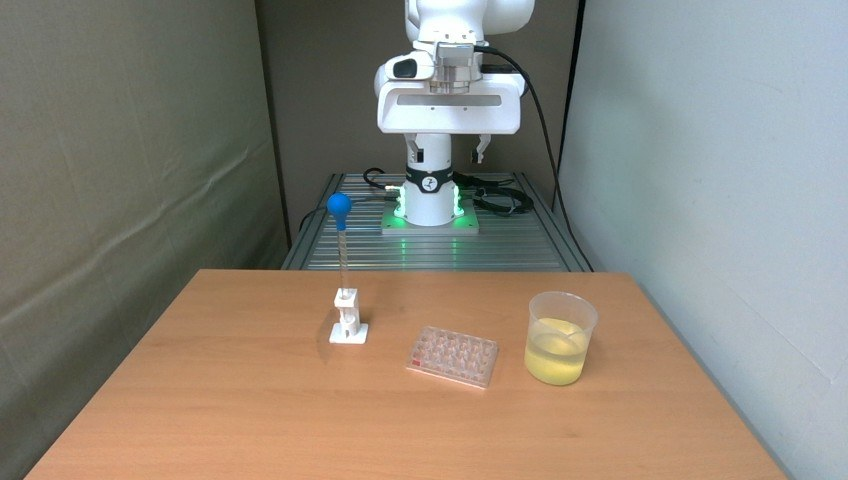 | 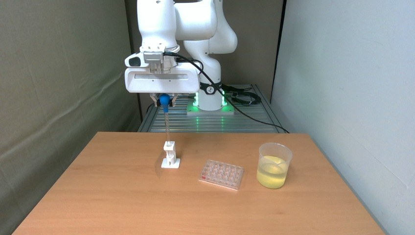 | 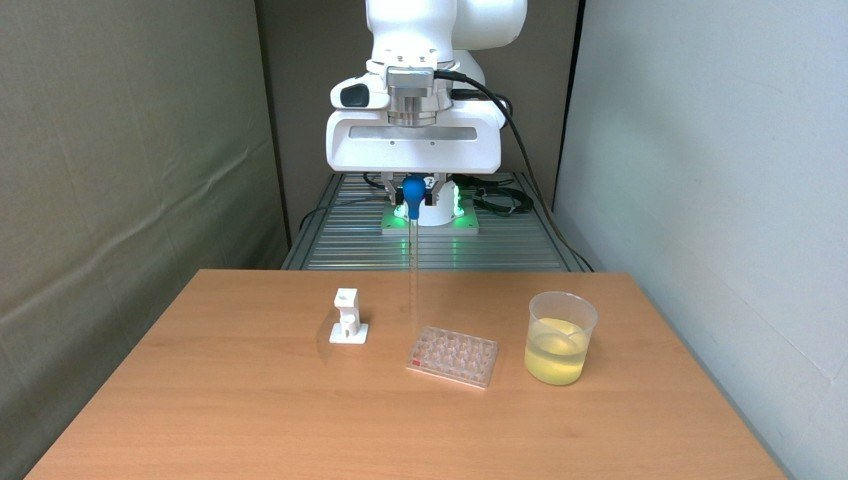 | 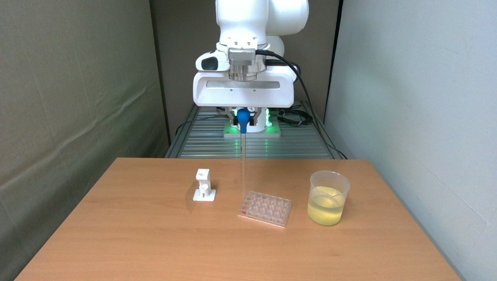 |
| 손목 | 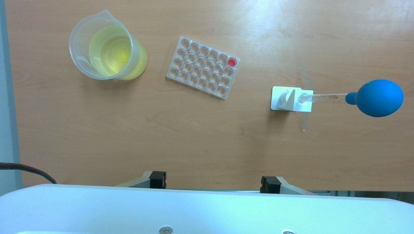 | 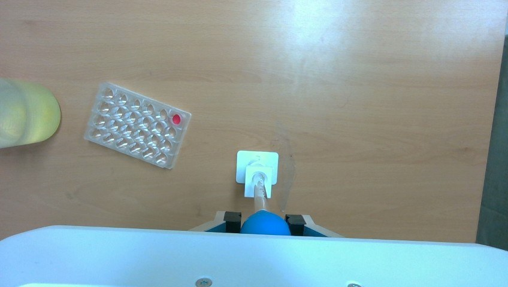 | 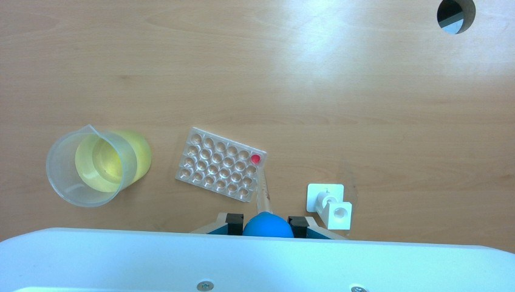 | 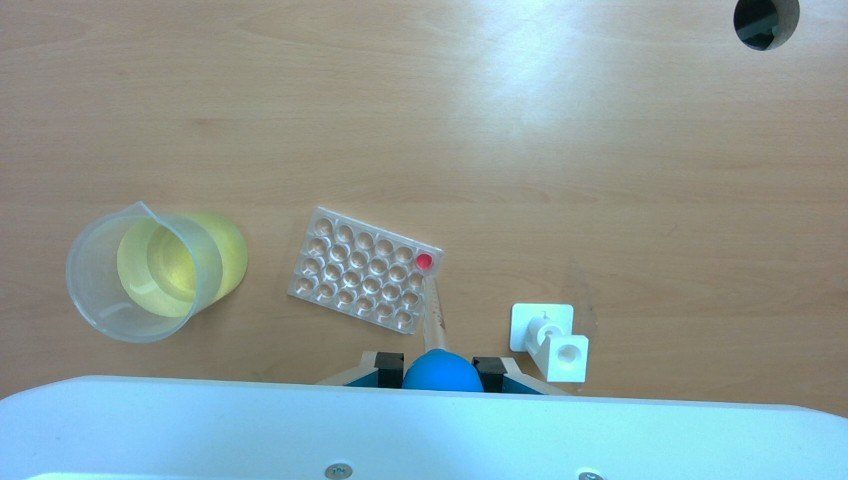 |

## 2. 데이터 수집 (자동 시연)

사람이 조종하지 않고, 스테이션이 스스로 동작을 계획해 실행하면서 기록했다. 학습된 모델은 쓰지 않았다.

| 항목 | 값 |
|---|---|
| 판 수 | **200판** (모두 성공 판, 물이 빨간 원판 위에 떨어진 판만 저장) |
| 배치 | 배치 계획 100개 × 2판. 판마다 판·빨간 칸·비커·거치대를 모두 옮김 |
| 빨간 칸 | 24칸 모두 사용 (칸마다 4–12판) |
| 판 자리·각도 | 빨간 칸 x 473–623 mm, y -104–80 mm (5–95%), 판 각도 -28° ~ +20° |
| 비커 · 거치대 | 판 양옆(y ±100–260 mm)에 번갈아, 비커 x 503–656 mm, 거치대 x 431–623 mm |
| 한 판 길이 | 가운데값 70.8 s (60.7–79.6 s). 학습에서는 멈춰 서 있는 구간을 줄여 판당 62.2 s |
| 학습 프레임 | 124,425프레임 (207분, 10 Hz) |
| 기록 | 3인칭·손목 사진, 관절, 손끝 위치·자세, 그리퍼 폭, 명령 |

**자동 시연이 하는 일**

- 홈 자세 손목 사진 한 장에서 24칸 판(칸 무늬 맞추기)과 빨간 원판, 비커 입구 원, 거치대를 찾는다. 화면 좌표는 손으로 맞춘 정답 쌍으로 보정한 평면 변환으로 로봇 좌표로 바꾼다(한 자리 빼고 검증 평균 1.9 mm, 최대 3.0 mm).
- 거치대는 스포이드 위로 가서 손목 화면의 파란 고무공을 맞춰 잡는 자리를 잰다(이 동작은 기록하지 않음).
- 잡기 → 뽑기 → 비커 → 칸 → 다시 꽂기까지 궤적을 계획하고, 칸 위에서는 손목 화면으로 빨간 원판을 보고 끝 자리를 한 번 더 맞춘 뒤 내려가 짠다.
- 판마다 스테이션이 기록 품질(끊김, 그리퍼 순서, 사진 차이 등)을 자동 점검했다. 200판 중 1판(거치대에서 쥔 직후 손가락이 너무 닫힘)을 빼고, 같은 배치로 1판을 다시 모아 200판을 맞췄다.

### 배치 분포

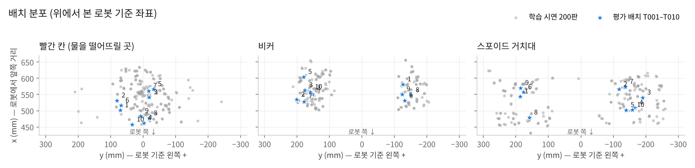

- 회색 점은 학습 시연 200판(뺀 89번 판 대신 다시 모은 판은 같은 배치라 89번 자리로 그림), 파란 별은 평가 배치 T001–T010이다(평가 때 스테이션이 잰 자리, 같은 배치 판들의 가운데값).
- 평가 배치는 수집에 쓰지 않았다. 스테이션이 모은 판들과 **가장 먼 배치부터** 골랐기 때문에, 데이터 가장자리에 있는 배치가 많다.

## 3. 학습

| 항목 | 값 |
|---|---|
| 모델 | GR00T N1.7 (3B), LeRobot으로 미세조정. 비전·언어 백본은 고정 |
| 데이터 | 자동 시연 200판 전부 (검증용으로 따로 빼지 않음) |
| 입력 | 3인칭·손목 사진 + 상태 10차원(손끝 위치 3 + 자세 rot6d 6 + 그리퍼 폭 1) + 지시문 |
| 행동 | 16스텝(1.6 s) 묶음, 손끝 위치·자세 + 그리퍼 단계(열림 1.0 · 쥠 0.667 · 누름 0.333 · 짬 0). 위치·자세는 상대 행동으로 학습(그리퍼 제외) |
| 설정 | 30,000스텝, 배치 32 × 2, 학습률 1e-4 코사인, bf16, 사진 증강 켬, 5,000스텝마다 저장 |
| 평가에 쓴 체크포인트 | **25,000스텝** (약 12.8 epoch) |

- 체크포인트는 실물로 비교해 고르지 않고 25,000스텝 하나로 정했다.
- 학습 loss는 30,000스텝까지 계속 내려갔다(5K 0.043 → 25K 0.0125 → 30K 0.011).

## 4. 평가 방법

### 4.1 설계 (결과를 보기 전에 정함)

- **배치:** 학습에 쓰지 않은 T001–T010. 사람이 배치 그림대로 판·빨간 원판·비커·거치대를 놓았다.
- **판 수:** 배치마다 조건별 5판 → **조건마다 50판**. 배치를 한 번 놓고 두 조건을 번갈아 돌렸다(예: VLA·수식·수식·VLA …). 다시 놓으면 자리가 10–30 mm 달라지기 때문이다.
- **묶음:** 평가 배치의 빨간 칸에서 20 mm 안에 학습 빨간 칸이 몇 판 있는지(계획 배치 기준)로 미리 나눴다.

| 묶음 | 배치 (학습 빨간 칸 20 mm 안 판 수) |
|---|---|
| 가까움 | T003 (13) · T007 (20) · T008 (10) · T009 (14) |
| 중간 | T001 (4) · T004 (4) · T005 (8) |
| 멂 | T002 (2) · T006 (2) · T010 (0) |

- **판정:** 사람 판정이 최종이다.
  - 성공: 빨간 원판 위에 물이 떨어짐
  - 부분: 스포이드를 쥐었지만 성공하지 못함
  - 실패: 스포이드를 쥐지 못함 (안전장치가 멈춘 판도 결과로 셈)
- **무효 (다시 돌림):** 시작 전 장면을 못 잰 판(S0) 3, 조건을 잘못 고른 판 1, 순서를 틀린 판 1.
- VLA + 수식은 첫 배치(T001)를 돌리는 동안 넘겨받는 규칙을 마지막 형태(4.2절)로 고쳤다. 그 전에 돌린 3판은 빼고 다시 돌려, 본 결과 50판은 모두 같은 규칙이다. VLA만은 처음부터 끝까지 같은 설정이다.
- **본 결과에서 뺀 판 2:** 실행 도중 'VLA + 수식' 체크가 켜져 두 조건이 섞인 판 1(T001, 성공), T001 VLA + 수식 5판을 채운 뒤 더 돌린 판 1(성공). `data/eval_runs_excluded.csv`에 따로 남겼다. 섞인 판 대신 T001 VLA만 1판을 평가 마지막에 다시 돌려 배치마다 5판을 맞췄다.
- **자동 판정 검토:** 자동 판정은 "쥔 자리가 거치대 잡는 자리에서 10 mm 안"일 때만 쥠으로 본다. 그래서 10–13 mm 옆을 쥐고도 뽑기·빨기·짜기까지 한 5판(모두 VLA만)이 자동으로 실패가 됐다. 미리 정한 기준대로 부분으로 고쳤다.

### 4.2 두 조건

| | VLA만 | VLA + 수식 |
|---|---|---|
| 잡기 | VLA | VLA가 고무공 25 mm(높이 40 mm) 안에서 쥐려 하면 수식이 넘겨받아 쥐고 뽑음 |
| 빨기·옮기기 | VLA | VLA |
| 짜기 | VLA | VLA가 판 위로 내려가거나 짜려 할 때, VLA 끝이 **빨간 칸 20 mm 안**이면 수식이 빨간 원판을 보고 맞춰 짬. 아니면 VLA 끝에서 9 mm 안의 칸에 짬 |
| 거치대에 다시 꽂기 (S10) | 수식 (점수에 안 셈) | 수식 (점수에 안 셈) |

- 수식은 VLA가 데려온 자리 근처에서만 동작하고, 수집 때 자동 시연과 같은 계산(판 찾기, 빨간 원판 맞춤, 궤적)을 쓴다. 모델과 입력은 두 조건이 같다.
- 20 mm는 칸 간격(19.3 mm)과 거의 같다.
- 넘겨받을지 판단할 때는 VLA가 보낸 손끝 명령에, 멈춰 있을 때 잰 "실제 − 명령" 처짐(몇 mm)을 더한 자리를 쓴다.

### 4.3 실행 설정 (두 조건 같음)

- 추론 서버에서 16스텝 묶음을 받아 앞 8스텝을 실행하고, 실행하는 동안 다음 묶음을 미리 요청한다. 추론 가운데값 약 126 ms.
- 이어 붙일 때 새 묶음 앞 4스텝을 앞 묶음과 섞어 속도가 꺾이지 않게 했다.
- 안전장치: 손끝 작업 상자, 책상 위 높이 하한, 손 기울기 15°, 0.1 s에 4 cm 넘는 행동이면 멈춤.
- 끝: 짠 뒤 풀고 2 s, 쥔 채 그리퍼를 열려 함(유리를 지키려고 열지 않음), 150 s, 안전장치.

### 4.4 S0–S10 단계 정의

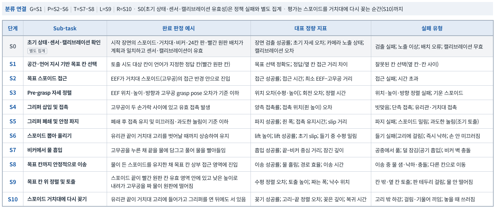

분류 연결: G = S1, P = S2–S6, T = S7–S8, L = S9, R = S10. S0·S1·S10은 따로 센다.

| 단계 | 분류 | Sub-task | 이 평가의 판정 |
|---|---|---|---|
| S0 | — | 초기 상태·센서·캘리브레이션 | 시작 장면(판·빨간 칸·비커·거치대)을 찾고 거치대를 재는 데 성공. 실패하면 모델이 돌지 않으므로 무효로 하고 다시 돌림 |
| S1 | G | 목표 칸 선택 | VLA가 짜려 한 자리에서 가장 가까운 칸이 빨간 칸. VLA만은 VLA가 짠 자리, VLA + 수식은 수식이 넘겨받을 때 VLA 끝 자리. 시점이 달라 누적에 넣지 않음 |
| S2 | P | 스포이드 접근 | 손끝이 거치대 잡는 자리 수평 25 mm · 높이 40 mm 안으로 들어감 |
| S3–S5 | P | 정렬 · 접촉 · 파지 | 힘·접촉 센서가 없어 셋을 나누지 않고, 실제로 쥐었는지(뽑기·빨기로 확인) 하나로 셈 |
| S6 | P | 뽑아 올리기 | 쥔 채 50 mm 넘게 올라감 |
| S7 | T | 비커에서 물 빨기 | 끝이 비커 안 물속에 있을 때 고무공을 풂 |
| S8 | T | 목표 칸까지 이송 | 물이 든 채 VLA가 짜려 한 자리가 빨간 칸 20 mm 안 |
| S9 | L | 칸 위 정렬 · 토출 | 사람 판정 성공 (빨간 원판에 물이 떨어짐) |
| S10 | R | 거치대에 다시 꽂기 | 두 조건 모두 수식이 함, 점수에 넣지 않음. 기록상 걸림 없이 꽂고 놓은 판 |

채점 규칙:

1. 판마다 처음 막힌 단계 하나를 정한다. 그 앞 단계는 통과, 뒤 단계는 실패로 센다. 그래서 S2–S9의 통과 수는 누적이다.
2. 뒤 단계를 통과했으면 앞 단계도 통과로 센다.
3. 사람 판정이 최종이다. 자동 판정과 사람 판정을 둘 다 남겼다(부록 A).
4. VLA가 짜려 한 자리는 관절값과 스포이드 길이로 계산한 끝 자리라 몇 mm 오차가 있다. VLA만 성공 3판은 계산상 옆 칸이 더 가까웠지만(빨간 칸에서 13.2–16.8 mm) 사람이 원판에 물이 떨어진 것을 확인했다.

## 5. 결과 — S0–S10 벤치마크

평가 기간: 2026-11-24 14:20 ~ 11-25 13:24. 체크포인트 25,000스텝.

### 5.1 단계별 통과 (S0–S10)

| 단계 | 분류 | Sub-task | VLA만 | VLA + 수식 |
|---|---|---|---|---|
| S0 | — | 초기 상태·센서 (따로, 시도한 판 중) | 50/52 (96%) — 무효 2: 컨트롤러 꺼짐 1, 거치대 재기 실패 1 | 50/51 (98%) — 무효 1: 거치대 재기 실패 |
| S1 | G | 목표 칸 선택 (따로) | 11/45 (24%) | 14/47 (30%) |
| S2 | P | 스포이드 접근 | 49/50 (98%) | 49/50 (98%) |
| S3–S5 | P | 정렬·접촉·파지 | 48/50 (96%) | 49/50 (98%) |
| S6 | P | 뽑아 올리기 | 48/50 (96%) | 49/50 (98%) |
| S7 | T | 비커에서 물 빨기 | 47/50 (94%) | 47/50 (94%) |
| S8 | T | 빨간 칸까지 이송 (20 mm 안) | 25/50 (50%) | 26/50 (52%) |
| **S9** | **L** | **빨간 원판에 토출 (최종 성공)** | **9/50 (18%, 10–31)** | **24/50 (48%, 35–61)** |
| S10 | R | 거치대에 다시 꽂기 (수식, 점수 밖) | 43/43 (100%) | 43/46 (93%) — 입구에 걸림 3 |

- S2–S9는 50판 중 누적 통과다. S0은 무효로 다시 돌린 판까지 센 시도 수, S1은 VLA가 판 위에서 짜려 한 판 수, S10은 수식이 꽂기를 시작한 판 수가 분모다.
- S10이 없는 판(VLA만 7, VLA + 수식 4)은 빈손이거나 안전장치·Space로 멈춰 정리 동작을 하지 않은 판이다.

### 5.2 단계 전환율

앞 단계를 통과한 판 중 이 단계를 통과한 비율이다.

| 단계 | VLA만 | VLA + 수식 |
|---|---|---|
| S2 접근 | 49/50 (98%) | 49/50 (98%) |
| S3–S5 쥐기 | 48/49 (98%) | 49/49 (100%) |
| S6 뽑기 | 48/48 (100%) | 49/49 (100%) |
| S7 빨기 | 47/48 (98%) | 47/49 (96%) |
| S8 빨간 칸 20 mm 안 | 25/47 (53%) | 26/47 (55%) |
| S9 원판에 떨굼 | 9/25 (36%) | 24/26 (92%) |

### 5.3 분류별 (G / P / T / L / R)

| 분류 | VLA만 | VLA + 수식 |
|---|---|---|
| G 목표 칸 선택 (S1) | 11/45 (24%) | 14/47 (30%) |
| P 쥐고 뽑기 (S2–S6) | 48/50 (96%) | 49/50 (98%) |
| T 빨기·옮기기 (S7–S8, P 통과 판 중) | 25/48 (52%) | 26/49 (53%) |
| L 토출 (S9, T 통과 판 중) | 9/25 (36%) | 24/26 (92%) |
| R 다시 꽂기 (S10, 수식) | 43/43 (100%) | 43/46 (93%) |

### 5.4 처음 막힌 단계

| 처음 막힌 단계 | VLA만 | VLA + 수식 |
|---|---|---|
| S2 접근 못 함 | 1 | 1 |
| S3–S5 못 쥠 | 1 | 0 |
| S6 못 뽑음 | 0 | 0 |
| S7 못 빪 | 1 | 2 |
| S8 빨간 칸 20 mm 밖 | 22 | 21 |
| S9 원판 밖에 떨굼 | 16 | 2 |
| 통과 (성공) | 9 | 24 |

- 잡기 전·잡기·빨기에서 멈춘 판(S2–S7)은 조건마다 3판이고, 모두 안전장치 멈춤(0.1 s에 4 cm 넘는 행동)이거나 빈손이다.
  - VLA만: 시작 직후 안전 멈춤 1, 거치대 13 mm 옆에서 닫아 빈손 1, 빨기 중 안전 멈춤 1
  - VLA + 수식: 시작 직후 안전 멈춤 1, 빨기 중 안전 멈춤 2
- 안전 멈춤은 모두 6판(VLA만 3, VLA + 수식 3)이고, 1판은 판 위에서 멈췄다(VLA만, S8).

### 5.5 단계별 정량 지표

가운데값 (최소–최대). 시각은 실행 시작부터, 그리퍼 명령을 보낸 때다.

| 단계 | 지표 | VLA만 | VLA + 수식 |
|---|---|---|---|
| S2 | 쥐기 시작 시각 (s) — VLA + 수식은 VLA가 쥐려 해 수식이 넘겨받은 때 | 10.6 (9.1–21.1) | 6.3 (5.3–18.6) |
| S3–S5 | 쥔 자리 ↔ 거치대 잡는 자리, 수평 (mm) — VLA + 수식은 수식 도착 오차 | 5.9 (0.8–13.3) | 0.7 (0.1–1.7) |
| S3–S5 | 쥔 높이 − 잡는 높이 (mm) | -1.3 (-6.0–5.8) | 0.0 (수식) |
| S6 | 뽑아 올린 높이 (mm) | 143 (107–148) | 141 (122–149) |
| S7 | 물을 빤 시각 (s) | 27.5 (19.6–37.9) | 34.6 (26.2–47.0) |
| S7 | 빨 때 끝 ↔ 비커 가운데 (mm) | 16.1 (2.1–33.2) | 18.6 (3.1–35.0) |
| S7 | 빨 때 끝이 물 아래로 들어간 깊이 (mm) | 13.7 (9.9–17.0) | 13.6 (8.6–17.6) |
| S7 | 공중·물속에서 누름 → 풂을 두 번 넘게 한 판 | 11/47 | 8/47 |
| S8 | VLA가 짜려 한 자리 ↔ 빨간 칸 가운데 (mm) | 19.0 (1.3–65.9) | 18.2 (0.8–85.7) |
| S8 | 그중 원판 반지름 7 mm 안 / 20 mm 안 | 4 / 25 (/45) | 5 / 26 (/47) |
| S8 | 짜려 한 시각 (s) — VLA + 수식은 수식이 넘겨받은 때 | 53.1 (41.0–121.6) | 39.5 (35.4–52.8) |
| S9 | 수식이 빨간 원판을 보고 끝을 옮긴 거리 (mm) | — | 5.2 (1.9–7.1) |
| S9 | 성공 판 걸린 시간 (s, 다시 꽂기 전까지) | 56.2 (46.2–70.5) | 65.7 (61.3–81.4) |
| S10 | 다시 꽂고 홈까지 (s, 수식) | 19.3 (17.9–21.8) | 19.5 (18.3–21.0) |
| — | 추론 시간 (ms, 판마다 가운데값) | 126 (124–247) | 127 (124–249) |
| — | 한 판에 받은 행동 묶음 수 | 42 (2–110) | 21 (2–58) |

### 5.6 VLA + 수식 — 수식이 넘겨받은 동작

| 수식 넘김 (VLA + 수식 50판) | 판 수 | 결과 |
|---|---|---|
| 잡기를 넘겨받음 | 49 | 49판 모두 쥐고 뽑음. 도착 오차 0.7 (0.1–1.7) mm |
| 잡기를 못 넘겨받음 | 1 | 시작 1.5 s에 안전장치 멈춤 (실패) |
| 빨간 칸 20 mm 안 → 빨간 칸에 짬 | 26 | **성공 24**, 부분 2 (물이 원판에 안 떨어짐 1, 내려가다 판 테두리에 걸림 1). 넘겨받을 때 VLA 끝 11.3 (0.8–19.6) mm |
| └ 그중 VLA가 스스로 빨간 칸에 가장 가깝게 간 판 | 13 | 나머지 13판은 VLA가 옆 칸에 더 가까웠지만 빨간 칸이 20 mm 안이었음 |
| 빨간 칸 20 mm 밖 → VLA 끝 9 mm 안의 칸에 짬 | 18 | 모두 부분 (VLA 끝 ↔ 빨간 칸 20.3–53.1 mm) |
| 짜기를 넘겨받지 않음 | 6 | 빨기 중 안전 멈춤 2, VLA가 칸 사이·먼 곳에서 바로 짬 3 (30–86 mm), 시작 직후 멈춤 1 |

- 왼쪽은 VLA만 판에서 VLA가 짠 자리, 오른쪽은 VLA + 수식 판에서 수식이 넘겨받을 때 VLA 끝 자리다. 빨간 칸 가운데를 (0, 0)에 두었다.
- 두 조건에서 VLA가 가는 자리의 퍼짐은 비슷하다. VLA만은 원판(빨간 원) 안에 들어온 판만 성공했고, VLA + 수식은 20 mm 원 안의 판을 수식이 원판에 맞췄다.

### 5.7 묶음별 · 배치별

| 묶음 (평가 전에 정함) | VLA만 | VLA + 수식 | Fisher p |
|---|---|---|---|
| 가까움 (T003 · T007 · T008 · T009) | 4/20 (20%, 8–42) | 11/20 (55%, 34–74) | 0.048 |
| 중간 (T001 · T004 · T005) | 4/15 (27%, 11–52) | 7/15 (47%, 25–70) | 0.45 |
| 멂 (T002 · T006 · T010) | 1/15 (7%, 1–30) | 6/15 (40%, 20–64) | 0.08 |
| **전체** | **9/50 (18%, 10–31)** | **24/50 (48%, 35–61)** | **0.0026** |

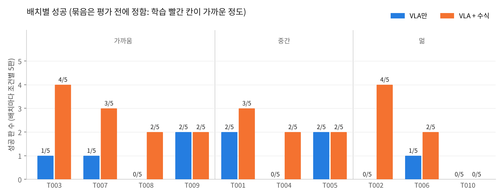

| 배치 | 묶음 | 빨간 칸 (번호, x, y mm) | 학습 빨간 칸 20 mm 안 | VLA만 S8 / S9 | VLA + 수식 S8 / S9 |
|---|---|---|---|---|---|
| T003 | 가까움 | 2번 (542, -19) | 13 | 1/5 · **1/5** | 4/5 · **4/5** |
| T007 | 가까움 | 5번 (561, -17) | 20 | 3/5 · **1/5** | 3/5 · **3/5** |
| T008 | 가까움 | 16번 (476, -18) | 10 | 5/5 · **0/5** | 2/5 · **2/5** |
| T009 | 가까움 | 23번 (483, +8) | 14 | 5/5 · **2/5** | 2/5 · **2/5** |
| T001 | 중간 | 13번 (501, +70) | 4 | 3/5 · **2/5** | 4/5 · **3/5** |
| T004 | 중간 | 20번 (462, -2) | 4 | 2/5 · **0/5** | 3/5 · **2/5** |
| T005 | 중간 | 6번 (566, -32) | 8 | 3/5 · **2/5** | 2/5 · **2/5** |
| T002 | 멂 | 1번 (531, +80) | 2 | 1/5 · **0/5** | 4/5 · **4/5** |
| T006 | 멂 | 7번 (516, +68) | 2 | 2/5 · **1/5** | 2/5 · **2/5** |
| T010 | 멂 | 19번 (457, +34) | 0 | 0/5 · **0/5** | 0/5 · **0/5** |

## 6. 한계

- 조건마다 50판, 배치마다 5판이다. 배치별·묶음별 차이는 판 수가 적어 대부분 통계적으로 확정되지 않는다(가까움 묶음만 p < 0.05).
- 평가는 이틀(11-24 오후, 11-25 오전)에 걸쳐 배치 차례대로 했다. 한 배치 안에서는 두 조건을 번갈아 돌렸다.
- 체크포인트는 실물로 비교해 고르지 않았다(25,000스텝 하나).
- S3–S5는 힘·접촉 센서가 없어 나누지 못했다. S10은 두 조건 모두 수식이 했고 사람이 따로 판정하지 않았다.
- VLA + 수식에서 빨간 칸에 짠 26판 중 13판은 VLA가 옆 칸에 더 가까웠다. 이 판들은 빨간 칸이 20 mm 안이라 수식이 빨간 칸에 짰다.
- VLA + 수식 판은 수식이 짜는 순간 기록이 끝나 물이 떨어지는 장면이 기록에 없다. 성공은 사람이 현장에서 판정했다.
- 학습 때 본 배치에서의 성능은 재지 않았다.

## 7. 파일

파일은 모두 [`FR3_spoid_results/FR3_dropper/`](FR3_spoid_results/FR3_dropper/) 폴더 안에 있다. 표의 경로는 그 폴더 기준이다.

| 파일 | 내용 |
|---|---|
| `data/eval_runs.csv` | 평가 100판: 배치, 묶음, 조건, 결과, 판정(사람/자동/검토), 처음 막힌 단계, S1–S10, VLA가 짜려 한 자리 ↔ 빨간 칸 거리, 수식 넘김, 내용 |
| `data/eval_runs_excluded.csv` | 본 결과에서 뺀 2판과 이유 |
| `data/eval_layouts.csv` | 평가 배치 T001–T010의 빨간 칸·비커·거치대 자리 |
| `data/train_layouts.csv` | 학습 시연 200판의 빨간 칸·판·비커·거치대 자리 |
| `assets/demo_vla.*`, `assets/demo_hybrid.*` | 영상 (GIF 3배 빠르게, mp4 원래 속도) |
| `assets/frames/` | 실행 장면 사진 8장 |
| `assets/*.png` | 그림 |

좌표는 로봇 기준 mm다(x: 로봇에서 앞쪽, y: 로봇 기준 왼쪽 +).

---

## 부록 A. 판별 채점

판 이름은 배치마다 조건별로 돌린 차례다. "처음 막힌 단계"가 —이면 S9까지 통과(성공)다. "판정"의 (자동 …)은 스테이션 자동 판정과 사람 판정이 다른 판이다.
VLA 끝 ↔ 빨간 칸은 VLA만은 짠 자리, VLA + 수식은 수식이 넘겨받을 때의 VLA 끝 자리다.

<b>VLA만 (50판)</b>

| 판 | 시각 | 판정 | 처음 막힌 단계 | 잡기 / 짜기 | VLA 끝 ↔ 빨간 칸 (mm) | 내용 |
|---|---|---|---|---|---|---|
| T001-VLA-1 | 11-24 14:20 | 성공 | — | VLA / VLA | 2.7 | 빨간 원판에 떨굼 — 짠 자리 2.7 mm (계산값) |
| T001-VLA-2 | 11-24 15:32 | 부분 | S9 | VLA / VLA | 12.8 | 빨간 칸 12.8 mm에서 짬 — 원판 밖 |
| T001-VLA-3 | 11-24 15:36 | 부분 | S8 | VLA / VLA | 22.1 | 빨간 칸에서 22.1 mm 떨어진 곳(옆 칸 쪽)에서 짬 |
| T001-VLA-4 | 11-24 15:50 | 실패 | S2 | VLA / VLA |  | 시작 직후 안전장치 멈춤 (0.1 s에 4.2 cm) |
| T001-VLA-5 | 11-25 13:24 | 성공 (자동 부분) | — | VLA / VLA | 16.8 | 빨간 원판에 떨굼 — 짠 자리 16.8 mm (계산값) |
| T002-VLA-1 | 11-24 16:03 | 부분 | S9 | VLA / VLA | 11.1 | 빨간 칸 11.1 mm에서 짬 — 원판 밖 |
| T002-VLA-2 | 11-24 16:21 | 부분 | S8 | VLA / VLA | 23.7 | 빨간 칸에서 23.7 mm 떨어진 곳(옆 칸 쪽)에서 짬 |
| T002-VLA-3 | 11-24 16:25 | 부분 | S8 | VLA / VLA | 44.9 | 빨간 칸에서 44.9 mm 떨어진 곳(옆 칸 쪽)에서 짬 |
| T002-VLA-4 | 11-24 16:35 | 부분 | S8 | VLA / VLA | 20.3 | 빨간 칸에서 20.3 mm 떨어진 곳(옆 칸 쪽)에서 짬 |
| T002-VLA-5 | 11-24 16:38 | 부분 | S7 | VLA / VLA |  | 빨기 중 안전장치 멈춤 (0.1 s에 4.5 cm) |
| T003-VLA-1 | 11-24 16:47 | 실패 | S3–S5 | VLA / VLA |  | 거치대 13 mm 옆에서 닫아 빈손으로 올라옴 |
| T003-VLA-2 | 11-24 16:58 | 부분 (자동 실패) | S8 | VLA / VLA | 25.6 | 거치대 11 mm 옆을 쥐고 진행 (자동 실패 → 검토로 부분) · 빨간 칸에서 25.6 mm 떨어진 곳(옆 칸 쪽)에서 짬 |
| T003-VLA-3 | 11-24 17:02 | 성공 (자동 부분) | — | VLA / VLA | 8.3 | 빨간 원판에 떨굼 — 짠 자리 8.3 mm (계산값) |
| T003-VLA-4 | 11-24 17:13 | 부분 (자동 실패) | S8 | VLA / VLA | 27.2 | 거치대 10 mm 옆을 쥐고 진행 (자동 실패 → 검토로 부분) · 빨간 칸에서 27.2 mm 떨어진 곳(옆 칸 쪽)에서 짬 |
| T003-VLA-5 | 11-24 17:17 | 부분 (자동 실패) | S8 | VLA / VLA | 38.6 | 거치대 13 mm 옆을 쥐고 진행 (자동 실패 → 검토로 부분) · 빨간 칸에서 38.6 mm 떨어진 곳(옆 칸 쪽)에서 짬 |
| T004-VLA-1 | 11-24 17:25 | 부분 | S9 | VLA / VLA | 19.0 | 빨간 칸 19.0 mm에서 짬 — 원판 밖 |
| T004-VLA-2 | 11-24 17:40 | 부분 | S8 | VLA / VLA | 28.4 | 빨간 칸에서 28.4 mm 떨어진 곳(옆 칸 쪽)에서 짬 |
| T004-VLA-3 | 11-24 17:44 | 부분 | S8 | VLA / VLA | 29.6 | 빨간 칸에서 29.6 mm 떨어진 곳(옆 칸 쪽)에서 짬 |
| T004-VLA-4 | 11-24 17:59 | 부분 | S8 | VLA / VLA | 30.1 | 빨간 칸에서 30.1 mm 떨어진 곳(옆 칸 쪽)에서 짬 |
| T004-VLA-5 | 11-24 18:11 | 부분 | S9 | VLA / VLA | 16.6 | 빨간 칸 16.6 mm에서 짬 — 원판 밖 |
| T005-VLA-1 | 11-24 18:17 | 성공 (자동 부분) | — | VLA / VLA | 7.2 | 빨간 원판에 떨굼 — 짠 자리 7.2 mm (계산값) |
| T005-VLA-2 | 11-24 18:22 | 성공 | — | VLA / VLA | 1.3 | 빨간 원판에 떨굼 — 짠 자리 1.3 mm (계산값) |
| T005-VLA-3 | 11-24 18:28 | 부분 | S9 | VLA / VLA | 7.6 | 빨간 칸 7.6 mm에서 짬 — 원판 밖 |
| T005-VLA-4 | 11-24 18:38 | 부분 | S8 | VLA / VLA | 25.8 | 빨간 칸에서 25.8 mm 떨어진 곳(옆 칸 쪽)에서 짬 |
| T005-VLA-5 | 11-24 18:41 | 부분 | S8 | VLA / VLA | 60.9 | 빨간 칸에서 60.9 mm 떨어진 곳(옆 칸 쪽)에서 짬 |
| T006-VLA-1 | 11-24 18:48 | 부분 | S9 | VLA / VLA | 8.5 | 빨간 칸 8.5 mm에서 짬 — 원판 밖 |
| T006-VLA-2 | 11-24 18:59 | 부분 | S8 | VLA / VLA | 27.3 | 빨간 칸에서 27.3 mm 떨어진 곳(옆 칸 쪽)에서 짬 |
| T006-VLA-3 | 11-24 19:02 | 부분 | S8 | VLA / VLA |  | 판 위에서 안전장치 멈춤 (0.1 s에 6.6 cm) |
| T006-VLA-4 | 11-24 19:11 | 성공 (자동 부분) | — | VLA / VLA | 13.2 | 빨간 원판에 떨굼 — 짠 자리 13.2 mm (계산값) |
| T006-VLA-5 | 11-24 19:13 | 부분 | S8 | VLA / VLA | 20.9 | 빨간 칸에서 20.9 mm 떨어진 곳(옆 칸 쪽)에서 짬 |
| T007-VLA-1 | 11-25 08:51 | 부분 | S9 | VLA / VLA | 13.4 | 빨간 칸 13.4 mm에서 짬 — 원판 밖 |
| T007-VLA-2 | 11-25 10:31 | 부분 (자동 실패) | S9 | VLA / VLA | 18.8 | 거치대 12 mm 옆을 쥐고 진행 (자동 실패 → 검토로 부분) · 빨간 칸 18.8 mm에서 짬 — 원판 밖 |
| T007-VLA-3 | 11-25 10:34 | 성공 (자동 부분) | — | VLA / VLA | 9.1 | 빨간 원판에 떨굼 — 짠 자리 9.1 mm (계산값) |
| T007-VLA-4 | 11-25 10:44 | 부분 | S8 | VLA / VLA |  | 물을 빤 뒤 판 쪽으로 가다 멈춤 |
| T007-VLA-5 | 11-25 10:47 | 부분 | S8 | VLA / VLA | 29.5 | 빨간 칸에서 29.5 mm 떨어진 곳(옆 칸 쪽)에서 짬 |
| T008-VLA-1 | 11-25 10:57 | 부분 (자동 실패) | S9 | VLA / VLA | 15.1 | 거치대 13 mm 옆을 쥐고 진행 (자동 실패 → 검토로 부분) · 빨간 칸 15.1 mm에서 짬 — 원판 밖 |
| T008-VLA-2 | 11-25 11:11 | 부분 | S9 | VLA / VLA | 19.3 | 빨간 칸 19.3 mm에서 짬 — 원판 밖 |
| T008-VLA-3 | 11-25 11:14 | 부분 | S9 | VLA / VLA | 8.9 | 빨간 칸 8.9 mm에서 짬 — 원판 밖 |
| T008-VLA-4 | 11-25 11:23 | 부분 | S9 | VLA / VLA | 17.3 | 빨간 칸 17.3 mm에서 짬 — 원판 밖 |
| T008-VLA-5 | 11-25 11:26 | 부분 | S9 | VLA / VLA | 13.5 | 빨간 칸 13.5 mm에서 짬 — 원판 밖 |
| T009-VLA-1 | 11-25 11:32 | 부분 | S9 | VLA / VLA | 15.3 | 빨간 칸 15.3 mm에서 짬 — 원판 밖 |
| T009-VLA-2 | 11-25 11:41 | 성공 | — | VLA / VLA | 6.5 | 빨간 원판에 떨굼 — 짠 자리 6.5 mm (계산값) |
| T009-VLA-3 | 11-25 11:44 | 성공 (자동 부분) | — | VLA / VLA | 13.2 | 빨간 원판에 떨굼 — 짠 자리 13.2 mm (계산값) |
| T009-VLA-4 | 11-25 11:52 | 부분 (자동 성공) | S9 | VLA / VLA | 5.9 | 빨간 칸 5.9 mm에서 짰지만 물이 원판에 안 떨어짐 (사람 판정) |
| T009-VLA-5 | 11-25 11:56 | 부분 | S9 | VLA / VLA | 19.9 | 빨간 칸 19.9 mm에서 짬 — 원판 밖 |
| T010-VLA-1 | 11-25 12:02 | 부분 | S8 | VLA / VLA | 26.4 | 빨간 칸에서 26.4 mm 떨어진 곳(옆 칸 쪽)에서 짬 |
| T010-VLA-2 | 11-25 12:11 | 부분 | S8 | VLA / VLA | 65.9 | 빨간 칸에서 65.9 mm 떨어진 곳(옆 칸 쪽)에서 짬 |
| T010-VLA-3 | 11-25 12:22 | 부분 | S8 | VLA / VLA | 22.4 | 빨간 칸에서 22.4 mm 떨어진 곳(옆 칸 쪽)에서 짬 |
| T010-VLA-4 | 11-25 12:26 | 부분 | S8 | VLA / VLA | 27.0 | 빨간 칸에서 27.0 mm 떨어진 곳(옆 칸 쪽)에서 짬 |
| T010-VLA-5 | 11-25 13:00 | 부분 | S8 | VLA / VLA | 24.2 | 빨간 칸에서 24.2 mm 떨어진 곳(옆 칸 쪽)에서 짬 |

<b>VLA + 수식 (50판)</b>

| 판 | 시각 | 판정 | 처음 막힌 단계 | 잡기 / 짜기 | VLA 끝 ↔ 빨간 칸 (mm) | 내용 |
|---|---|---|---|---|---|---|
| T001-수식-1 | 11-24 15:19 | 성공 | — | 수식 / 수식(빨간 칸) | 6.8 | 수식이 빨간 원판에 맞춰 짬 — 넘겨받을 때 VLA 끝 6.8 mm |
| T001-수식-2 | 11-24 15:28 | 성공 | — | 수식 / 수식(빨간 칸) | 8.2 | 수식이 빨간 원판에 맞춰 짬 — 넘겨받을 때 VLA 끝 8.2 mm |
| T001-수식-3 | 11-24 15:40 | 성공 | — | 수식 / 수식(빨간 칸) | 10.9 | 수식이 빨간 원판에 맞춰 짬 — 넘겨받을 때 VLA 끝 10.9 mm |
| T001-수식-4 | 11-24 15:44 | 부분 (자동 성공) | S9 | 수식 / 수식(빨간 칸) | 12.0 | 수식이 빨간 칸에 짰지만 물이 원판에 안 떨어짐 (사람 판정) — 넘겨받을 때 VLA 끝 12.0 mm |
| T001-수식-5 | 11-24 19:22 | 부분 | S7 | 수식 / — |  | 빨기 중 안전장치 멈춤 (0.1 s에 4.6 cm) |
| T002-수식-1 | 11-24 16:09 | 부분 | S8 | 수식 / 수식(옆 칸) | 24.7 | VLA 끝이 빨간 칸에서 24.7 mm → 수식이 그 옆 칸(7번)에 짬 |
| T002-수식-2 | 11-24 16:14 | 성공 | — | 수식 / 수식(빨간 칸) | 11.7 | 수식이 빨간 원판에 맞춰 짬 — 넘겨받을 때 VLA 끝 11.7 mm (VLA는 옆 칸에 더 가까웠음) |
| T002-수식-3 | 11-24 16:28 | 성공 | — | 수식 / 수식(빨간 칸) | 0.8 | 수식이 빨간 원판에 맞춰 짬 — 넘겨받을 때 VLA 끝 0.8 mm |
| T002-수식-4 | 11-24 16:31 | 성공 | — | 수식 / 수식(빨간 칸) | 8.1 | 수식이 빨간 원판에 맞춰 짬 — 넘겨받을 때 VLA 끝 8.1 mm |
| T002-수식-5 | 11-24 16:40 | 성공 | — | 수식 / 수식(빨간 칸) | 13.0 | 수식이 빨간 원판에 맞춰 짬 — 넘겨받을 때 VLA 끝 13.0 mm (VLA는 옆 칸에 더 가까웠음) |
| T003-수식-1 | 11-24 16:50 | 성공 | — | 수식 / 수식(빨간 칸) | 9.9 | 수식이 빨간 원판에 맞춰 짬 — 넘겨받을 때 VLA 끝 9.9 mm |
| T003-수식-2 | 11-24 16:54 | 성공 | — | 수식 / 수식(빨간 칸) | 14.1 | 수식이 빨간 원판에 맞춰 짬 — 넘겨받을 때 VLA 끝 14.1 mm (VLA는 옆 칸에 더 가까웠음) |
| T003-수식-3 | 11-24 17:05 | 성공 | — | 수식 / 수식(빨간 칸) | 8.6 | 수식이 빨간 원판에 맞춰 짬 — 넘겨받을 때 VLA 끝 8.6 mm |
| T003-수식-4 | 11-24 17:09 | 성공 | — | 수식 / 수식(빨간 칸) | 18.0 | 수식이 빨간 원판에 맞춰 짬 — 넘겨받을 때 VLA 끝 18.0 mm (VLA는 옆 칸에 더 가까웠음) |
| T003-수식-5 | 11-24 17:20 | 부분 | S8 | 수식 / 수식(옆 칸) | 21.6 | VLA 끝이 빨간 칸에서 21.6 mm → 수식이 그 옆 칸(1번)에 짬 |
| T004-수식-1 | 11-24 17:31 | 성공 | — | 수식 / 수식(빨간 칸) | 4.7 | 수식이 빨간 원판에 맞춰 짬 — 넘겨받을 때 VLA 끝 4.7 mm |
| T004-수식-2 | 11-24 17:35 | 부분 | S8 | 수식 / VLA | 40.5 | VLA가 빨간 칸 40.5 mm에서 바로 짬 (넘겨받는 조건 밖) |
| T004-수식-3 | 11-24 17:50 | 성공 | — | 수식 / 수식(빨간 칸) | 4.3 | 수식이 빨간 원판에 맞춰 짬 — 넘겨받을 때 VLA 끝 4.3 mm |
| T004-수식-4 | 11-24 17:54 | 부분 | S9 | 수식 / 수식(빨간 칸) | 15.8 | 수식이 원판을 맞추다 끝이 판 테두리 쪽으로 가서 내려가다 걸려 멈춤 — 넘겨받을 때 VLA 끝 15.8 mm |
| T004-수식-5 | 11-24 18:13 | 부분 | S8 | 수식 / 수식(옆 칸) | 24.0 | VLA 끝이 빨간 칸에서 24.0 mm → 수식이 그 옆 칸(15번)에 짬 |
| T005-수식-1 | 11-24 18:20 | 실패 | S2 | VLA / — |  | 시작 직후 안전장치 멈춤 (0.1 s에 4.5 cm) |
| T005-수식-2 | 11-24 18:25 | 부분 | S8 | 수식 / VLA | 30.2 | VLA가 빨간 칸 30.2 mm에서 바로 짬 (넘겨받는 조건 밖) |
| T005-수식-3 | 11-24 18:32 | 부분 | S8 | 수식 / 수식(옆 칸) | 24.2 | VLA 끝이 빨간 칸에서 24.2 mm → 수식이 그 옆 칸(11번)에 짬 |
| T005-수식-4 | 11-24 18:35 | 성공 | — | 수식 / 수식(빨간 칸) | 8.9 | 수식이 빨간 원판에 맞춰 짬 — 넘겨받을 때 VLA 끝 8.9 mm |
| T005-수식-5 | 11-24 18:44 | 성공 | — | 수식 / 수식(빨간 칸) | 14.5 | 수식이 빨간 원판에 맞춰 짬 — 넘겨받을 때 VLA 끝 14.5 mm (VLA는 옆 칸에 더 가까웠음) |
| T006-수식-1 | 11-24 18:51 | 부분 | S8 | 수식 / 수식(옆 칸) | 23.3 | VLA 끝이 빨간 칸에서 23.3 mm → 수식이 그 옆 칸(14번)에 짬 |
| T006-수식-2 | 11-24 18:56 | 성공 | — | 수식 / 수식(빨간 칸) | 7.1 | 수식이 빨간 원판에 맞춰 짬 — 넘겨받을 때 VLA 끝 7.1 mm |
| T006-수식-3 | 11-24 19:08 | 성공 | — | 수식 / 수식(빨간 칸) | 7.7 | 수식이 빨간 원판에 맞춰 짬 — 넘겨받을 때 VLA 끝 7.7 mm |
| T006-수식-4 | 11-24 19:16 | 부분 | S8 | 수식 / 수식(옆 칸) | 25.7 | VLA 끝이 빨간 칸에서 25.7 mm → 수식이 그 옆 칸(14번)에 짬 |
| T006-수식-5 | 11-24 19:19 | 부분 | S7 | 수식 / — |  | 빨기 중 안전장치 멈춤 (0.1 s에 4.0 cm) |
| T007-수식-1 | 11-25 08:54 | 부분 | S8 | 수식 / 수식(옆 칸) | 25.2 | VLA 끝이 빨간 칸에서 25.2 mm → 수식이 그 옆 칸(11번)에 짬 |
| T007-수식-2 | 11-25 10:18 | 성공 | — | 수식 / 수식(빨간 칸) | 14.7 | 수식이 빨간 원판에 맞춰 짬 — 넘겨받을 때 VLA 끝 14.7 mm (VLA는 옆 칸에 더 가까웠음) |
| T007-수식-3 | 11-25 10:37 | 성공 | — | 수식 / 수식(빨간 칸) | 18.2 | 수식이 빨간 원판에 맞춰 짬 — 넘겨받을 때 VLA 끝 18.2 mm (VLA는 옆 칸에 더 가까웠음) |
| T007-수식-4 | 11-25 10:41 | 성공 | — | 수식 / 수식(빨간 칸) | 12.3 | 수식이 빨간 원판에 맞춰 짬 — 넘겨받을 때 VLA 끝 12.3 mm (VLA는 옆 칸에 더 가까웠음) |
| T007-수식-5 | 11-25 10:52 | 부분 | S8 | 수식 / 수식(옆 칸) | 26.9 | VLA 끝이 빨간 칸에서 26.9 mm → 수식이 그 옆 칸(12번)에 짬 |
| T008-수식-1 | 11-25 11:04 | 성공 | — | 수식 / 수식(빨간 칸) | 19.6 | 수식이 빨간 원판에 맞춰 짬 — 넘겨받을 때 VLA 끝 19.6 mm (VLA는 옆 칸에 더 가까웠음) |
| T008-수식-2 | 11-25 11:07 | 부분 | S8 | 수식 / 수식(옆 칸) | 20.3 | VLA 끝이 빨간 칸에서 20.3 mm → 수식이 그 옆 칸(15번)에 짬 |
| T008-수식-3 | 11-25 11:17 | 성공 | — | 수식 / 수식(빨간 칸) | 5.9 | 수식이 빨간 원판에 맞춰 짬 — 넘겨받을 때 VLA 끝 5.9 mm |
| T008-수식-4 | 11-25 11:20 | 부분 | S8 | 수식 / 수식(옆 칸) | 25.3 | VLA 끝이 빨간 칸에서 25.3 mm → 수식이 그 옆 칸(15번)에 짬 |
| T008-수식-5 | 11-25 11:29 | 부분 | S8 | 수식 / 수식(옆 칸) | 41.5 | VLA 끝이 빨간 칸에서 41.5 mm → 수식이 그 옆 칸(14번)에 짬 |
| T009-수식-1 | 11-25 11:35 | 부분 | S8 | 수식 / 수식(옆 칸) | 22.1 | VLA 끝이 빨간 칸에서 22.1 mm → 수식이 그 옆 칸(22번)에 짬 |
| T009-수식-2 | 11-25 11:38 | 성공 | — | 수식 / 수식(빨간 칸) | 19.6 | 수식이 빨간 원판에 맞춰 짬 — 넘겨받을 때 VLA 끝 19.6 mm (VLA는 옆 칸에 더 가까웠음) |
| T009-수식-3 | 11-25 11:46 | 부분 | S8 | 수식 / 수식(옆 칸) | 20.5 | VLA 끝이 빨간 칸에서 20.5 mm → 수식이 그 옆 칸(22번)에 짬 |
| T009-수식-4 | 11-25 11:49 | 부분 | S8 | 수식 / 수식(옆 칸) | 24.5 | VLA 끝이 빨간 칸에서 24.5 mm → 수식이 그 옆 칸(18번)에 짬 |
| T009-수식-5 | 11-25 11:58 | 성공 | — | 수식 / 수식(빨간 칸) | 13.6 | 수식이 빨간 원판에 맞춰 짬 — 넘겨받을 때 VLA 끝 13.6 mm (VLA는 옆 칸에 더 가까웠음) |
| T010-수식-1 | 11-25 12:08 | 부분 | S8 | 수식 / 수식(옆 칸) | 38.4 | VLA 끝이 빨간 칸에서 38.4 mm → 수식이 그 옆 칸(21번)에 짬 |
| T010-수식-2 | 11-25 12:16 | 부분 | S8 | 수식 / 수식(옆 칸) | 53.1 | VLA 끝이 빨간 칸에서 53.1 mm → 수식이 그 옆 칸(22번)에 짬 |
| T010-수식-3 | 11-25 12:19 | 부분 | S8 | 수식 / 수식(옆 칸) | 35.6 | VLA 끝이 빨간 칸에서 35.6 mm → 수식이 그 옆 칸(15번)에 짬 |
| T010-수식-4 | 11-25 12:29 | 부분 | S8 | 수식 / 수식(옆 칸) | 43.3 | VLA 끝이 빨간 칸에서 43.3 mm → 수식이 그 옆 칸(21번)에 짬 |
| T010-수식-5 | 11-25 12:57 | 부분 | S8 | 수식 / VLA | 85.7 | VLA가 빨간 칸 85.7 mm에서 바로 짬 (넘겨받는 조건 밖) |

